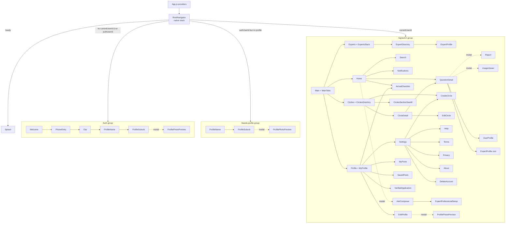
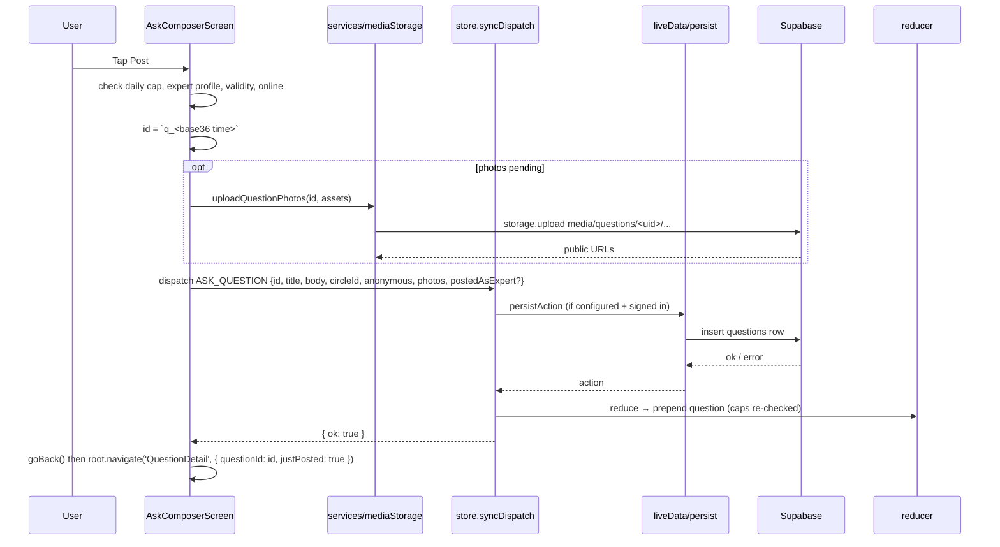
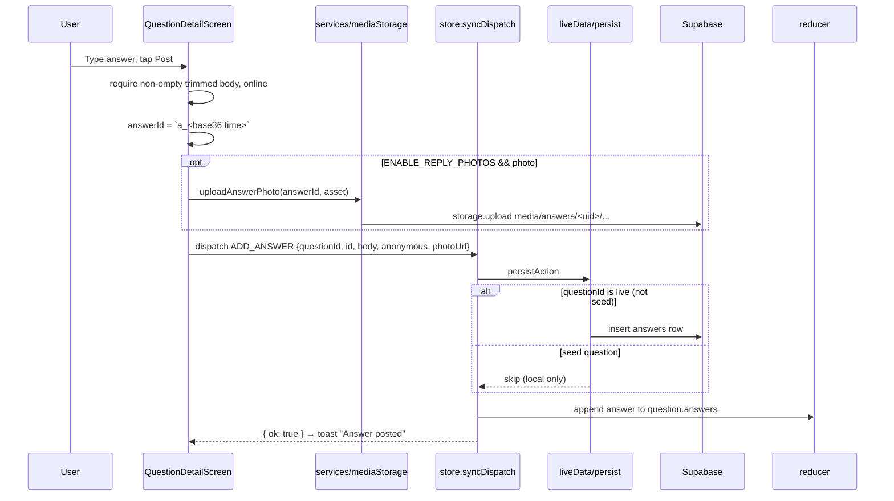
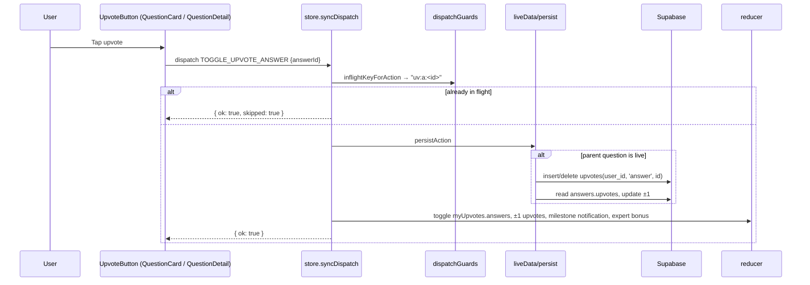

# Chautari App Map

Complete, file-by-file map of the Chautari codebase as of the structure cleanup (see [`CLEANUP_REPORT.md`](./CLEANUP_REPORT.md)). Every claim cites a file (and line where it matters). Anything that could not be verified from the code is marked **UNVERIFIED**.

Stack: Expo SDK 58, React Native 0.88, React 19.3, JavaScript only, React Navigation 7, Supabase JS. No TypeScript, no path aliases, Continuous Native Generation (no `android/` or `ios/` committed).

---

## 1. How to run

### Prerequisites

- Node 18+ and npm.
- A **development build** on a device/emulator. The project is on SDK 58; the store Expo Go targets an older SDK and will refuse the project. Build one with `npx eas build --platform android --profile preview` (profile in `eas.json`, produces an APK) or `npx expo run:android` / `npx expo run:ios` locally.
- Optional Supabase project for auth, profile sync, live Q&A and photo upload.

### Commands

| From | Command | Effect |
|---|---|---|
| outer workspace folder | `npm run start` | `npm --prefix chautari-test run start` → `expo start` |
| outer workspace folder | `npm run start:clear` | same with `-c` (clear Metro cache) |
| outer workspace folder | `npm run android` / `npm run ios` / `npm run web` | `expo start --android` etc. |
| outer workspace folder (Windows) | `start.cmd` | installs deps if `node_modules/expo` missing, then `npx expo start` |
| `chautari-test/` | `npm install` then `npx expo start` | same as above |
| `chautari-test/` | `npx expo-doctor` | project health (20 checks) |
| `chautari-test/` | `npx expo export --platform android` / `ios` | bundle check |
| `chautari-test/` | `node supabase/run-migrations.js` | apply SQL migrations (needs `SUPABASE_DB_URL`) |
| `chautari-test/` | `node supabase/verify.js` | verify schema (needs `SUPABASE_DB_URL`) |
| `chautari-test/` | `node supabase/scripts/run-sql.js <file.sql>` | run an ad-hoc SQL file |

### Environment variables

Defined in `.env` (gitignored; template in `.env.example`).

| Variable | Read in | Effect |
|---|---|---|
| `EXPO_PUBLIC_SUPABASE_URL` | `src/lib/supabase.js:5` | With the anon key, enables `isSupabaseConfigured()`. Unset → app runs fully offline on seed data, `authReady` is true immediately (`src/data/store.js:168`). |
| `EXPO_PUBLIC_SUPABASE_ANON_KEY` | `src/lib/supabase.js:6` | Anon key for the Supabase client. Never ship `service_role`. |
| `EXPO_PUBLIC_AUTH_DEV_MODE` | `src/lib/supabase.js:11-12` | Anything except the string `false` → `isAuthDevMode()` true → mock OTP in UI, real Supabase account created at onboarding finish via email/password (`src/services/auth.js:19-48`). `false` → real SMS OTP via `supabase.auth.signInWithOtp`. |
| `SUPABASE_DB_URL` | `supabase/run-migrations.js`, `supabase/verify.js`, `supabase/scripts/run-sql.js` | Direct Postgres URL for scripts only. Not read by the app. |

Code-level flags (not env): `ENABLE_REPLY_PHOTOS = true` in `src/constants/media.js:2`.

### Local persistence keys (AsyncStorage)

| Key | Written by | Contents |
|---|---|---|
| `chautari.state.v2` | `src/data/store.js:35, 831` | Whole reducer state minus `booted`, `authReady`, `authUserId` |
| `chautari.theme.v1` | `src/theme/ThemeContext.js:6, 17, 26` | `'light'` or `'dark'` (default `'light'`; no system-follow mode) |
| Supabase auth session | `src/lib/supabase.js:17` (`storage: AsyncStorage`) | Managed by supabase-js |

---

## 2. Annotated folder tree

```
chautari-test/
├── App.js                      Provider tree: SafeArea → ErrorBoundary → Theme → Data → Network → Toast → RootNavigator
├── index.js                    Expo entry (registerRootComponent)
├── app.json                    Expo config (name, icons, splash plugin, permissions)
├── eas.json                    EAS build profile "preview" → Android APK
├── babel.config.js / metro.config.js
├── .env.example                Env template
├── docs/                       APP_MAP, CLEANUP_REPORT, FEED_COMPOSITION, FEED_RANKING, PRD, BUILD_BRIEF, BUGS
├── supabase/
│   ├── migrations/             000..010 SQL (see §10). Never edit existing files.
│   ├── run-migrations.js       Applies migrations in order via `pg`
│   ├── verify.js               Sanity-checks schema
│   ├── scripts/run-sql.js      Run arbitrary SQL file
│   ├── scripts/grant_expert_ashish2.sql   One-off dev grant script
│   └── README.md               How to run migrations
└── src/
    ├── navigation/
    │   ├── RootNavigator.js    Native stack; auth vs signed-in groups; modal group; DigestManager mount
    │   ├── MainTabs.js         Bottom tabs: Home, Circles, Experts, Profile
    │   └── ExpertsStack.js     Nested stack inside Experts tab: ExpertDirectory → ExpertProfile
    ├── screens/                One folder per feature
    │   ├── auth/               Splash, Welcome, PhoneEntry, Otp, ProfileName, ProfileSuburb
    │   ├── home/               Home (feeds), Search, Notifications
    │   ├── questions/          QuestionDetail (thread, answer/reply composers), AskComposer
    │   ├── circles/            CirclesDirectory (tab), CircleDetail, CreateCircle, EditCircle, CirclesSectionSeeAll
    │   ├── experts/            ExpertDirectory (tab root), ExpertProfile, VerifiedApplication, ExpertProfessionalSetup
    │   ├── profile/            MyProfile (tab), UserProfile, EditProfile, MyPosts, SavedPosts
    │   ├── checklist/          ArrivalChecklist
    │   ├── settings/           Settings, Help, Terms, Privacy, About, DeleteAccount
    │   └── modals/             Report, ImageViewer, ProfilePhotoPreview
    ├── components/
    │   ├── common/             Design primitives + app chrome (ui.js, Button, Avatar, Toast, BackButton, ErrorBoundary, Skeleton, Motion, badges, DigestManager…)
    │   ├── feed/               QuestionCard, QuestionFeedList, FeedSortToggle, CirclesRecommendRow, ChecklistFeedCard, PinnedQuestionCard, ExpertMarker, QuestionCardPhotoThumb
    │   ├── question/           UpvoteButton, PhotoStrip, PhotoSourceSheet, SinglePhotoPicker, ContentPhoto, ExpertPost* (mode toggle, quota, fields, confirm)
    │   ├── circles/            CircleChip, CircleIcon, CircleDirectoryRow, CircleAboutSection, ExpertsHereRow, AccentSwatch
    │   └── profile/            ProfileView, FollowButton
    ├── data/
    │   ├── store.js            DataProvider: reducer, persistence, Supabase bootstrap, syncDispatch, useSelectors (1019 lines)
    │   ├── seed.js             6 seed users, 15 seed questions, seed following/notifications
    │   ├── circles.js          8 official circles, seed user circles, accent palette + presentation helpers, slugify, name checks
    │   ├── categories.js       CATEGORIES (8 official circle ids), SUBURBS, professionLabel()
    │   ├── checklist.js        10 "First 30 Days" items with deep-linked questionIds
    │   └── network.js          Mock online/offline context (toggle in Settings)
    ├── feed/
    │   ├── rankingConfig.js    Tunables: GRAVITY, WEIGHTS, PAGE_SIZE, DISCOVERY_RATIO, DISCOVERY_MIN_SCORE; score()
    │   ├── feedComposition.js  Joined pool + discovery pool → sort → 4:1 merge
    │   └── feedRanking.js      compareHot/compareNew, snapshot slicing, keyset cursor helpers
    ├── hooks/
    │   ├── useForYouFeed.js    Snapshot-per-session For You feed with Hot/New + pagination
    │   ├── useLiveDataRefresh.js  Focus-debounced (45s) Supabase refetch + forced pull-to-refresh
    │   ├── useImagePicker.js   Camera/library picker with iOS presentation wait
    │   ├── useProfilePhotoFlow.js Avatar pick → crop → preview modal → confirm
    │   └── useGoBack.js        Safe goBack with tab fallback; Android back handler
    ├── services/
    │   ├── auth.js             OTP / dev-mode email+password auth wrappers
    │   ├── profile.js          profiles row ↔ app user mapping; completeOnboarding; updateProfile
    │   ├── mediaStorage.js     Image staging/compress/upload to `media` bucket; per-target upload helpers
    │   ├── digest.js           Local notification digest: summary, schedule, permissions
    │   └── liveData/
    │       ├── index.js        Re-exports
    │       ├── fetch.js        fetchLiveBundle(): 7 parallel queries + profiles
    │       ├── persist.js      persistAction(): per-action Supabase writes for SYNC_ACTIONS
    │       ├── mappers.js      DB row → app shape (question/answer/reply/profile/circle)
    │       └── ids.js          UUID checks, seed-id detection, makeId()
    ├── lib/supabase.js         Supabase client + isSupabaseConfigured/isAuthDevMode
    ├── theme/                  ThemeContext (light/dark, persisted), palettes.js, tokens.js
    ├── constants/              media.js (upload limits), newcomer.js (60-day window)
    └── utils/                  navigation guards, format, karma, color, photos, expertPost, circleDirectory, dispatchGuards
```

---

## 3. Navigation

### Diagram



Gating logic (`src/navigation/RootNavigator.js:70-71`): `ready = state.booted && state.authReady && minTimePassed` (1500 ms minimum splash, line 66); `needsProfile = !!state.authUserId && !state.currentUserId`.

### Route table

All routes use `headerBackVisible: false` and a shared `BackButton` as `headerLeft` (`RootNavigator.js:95-97`, `ExpertsStack.js:18-19`).

| Route name | Navigator | Component | Header / presentation | Params |
|---|---|---|---|---|
| `Splash` | Root | `screens/auth/SplashScreen` | hidden, fade | – |
| `Welcome` | Root (auth) | `screens/auth/WelcomeScreen` | hidden | – |
| `PhoneEntry` | Root (auth) | `screens/auth/PhoneEntryScreen` | title `''` | – |
| `Otp` | Root (auth) | `screens/auth/OtpScreen` | title `''` | `phone`, `phoneE164` |
| `ProfileName` | Root (auth + needs-profile) | `screens/auth/ProfileNameScreen` | "Your profile" | `phone`, `phoneE164` |
| `ProfileSuburb` | Root (auth + needs-profile) | `screens/auth/ProfileSuburbScreen` | "Almost there" | `name`, `phone`, `phoneE164` |
| `ProfilePhotoPreview` | Root (auth, needs-profile, and signed-in modal group) | `screens/modals/ProfilePhotoPreviewScreen` | "Preview photo", modal, slide_from_bottom | `localUri`, `base64`, `mimeType`, `width`, `height`, `displayName`, `returnScreen` |
| `Main` | Root | `navigation/MainTabs` | hidden, fade | – |
| `Home` | MainTabs | `screens/home/HomeScreen` | tab | – |
| `Circles` | MainTabs | `screens/circles/CirclesDirectoryScreen` | tab | – |
| `Experts` | MainTabs | `navigation/ExpertsStack` | tab | – |
| `ExpertDirectory` | ExpertsStack | `screens/experts/ExpertDirectoryScreen` | hidden | – |
| `ExpertProfile` | ExpertsStack **and** Root | `screens/experts/ExpertProfileScreen` | `route.params.title` or "Expert" | `userId`, `title` |
| `Profile` | MainTabs | `screens/profile/MyProfileScreen` | tab | – |
| `QuestionDetail` | Root | `screens/questions/QuestionDetailScreen` | "Question" | `questionId`, `justPosted?`, `fromChecklist?` |
| `CircleDetail` | Root | `screens/circles/CircleDetailScreen` | title `''` | `circleId` |
| `CirclesSectionSeeAll` | Root | `screens/circles/CirclesSectionSeeAllScreen` | `CIRCLE_DIR_SEE_ALL_TITLES[sectionKey]` | `sectionKey` |
| `CreateCircle` | Root | `screens/circles/CreateCircleScreen` | "Create a Circle" | – |
| `EditCircle` | Root | `screens/circles/EditCircleScreen` | "Edit circle" | `circleId` |
| `Search` | Root | `screens/home/SearchScreen` | "Search" | `reset?` |
| `UserProfile` | Root | `screens/profile/UserProfileScreen` | `params.title` or "Profile" | `userId`, `title` |
| `VerifiedApplication` | Root | `screens/experts/VerifiedApplicationScreen` | "Become a Verified Expert" | – |
| `ExpertProfessionalSetup` | Root | `screens/experts/ExpertProfessionalSetupScreen` | "Expert profile setup" | – |
| `Notifications` | Root | `screens/home/NotificationsScreen` | "Activity" | – |
| `EditProfile` | Root | `screens/profile/EditProfileScreen` | "Edit profile" | – |
| `MyPosts` | Root | `screens/profile/MyPostsScreen` | "My Posts" | – |
| `SavedPosts` | Root | `screens/profile/SavedPostsScreen` | "Saved Posts" | – |
| `ArrivalChecklist` | Root | `screens/checklist/ArrivalChecklistScreen` | "First 30 Days" | – |
| `Settings` | Root | `screens/settings/SettingsScreen` | "Settings" | – |
| `Help` / `Terms` / `Privacy` / `About` | Root | `screens/settings/*` | "Help & FAQ" / "Terms & Conditions" / "Privacy Policy" / "About Chautari" | – |
| `DeleteAccount` | Root | `screens/settings/DeleteAccountScreen` | "Delete account" | – |
| `AskComposer` | Root modal group | `screens/questions/AskComposerScreen` | "Post a question", modal | `circleId?` (preselects circle, `AskComposerScreen.js:52`) |
| `Report` | Root modal group | `screens/modals/ReportScreen` | "Report", modal | `kind` (`'content'`/`'expert'`), `targetTitle` |
| `ImageViewer` | Root modal group | `screens/modals/ImageViewerScreen` | hidden, fullScreenModal, fade | `photos[]`, `index` |

Navigation helpers: `src/utils/navigation.js` (`useNavigationGuard` debounces double taps, `navigateToMainTab`, `openAuthorProfile` resolves anonymous/self/expert → `UserProfile`/`ExpertProfile`/Profile tab), `src/hooks/useGoBack.js` (fallback to a tab when the stack is shallow).

---

## 4. Screen catalog

| Screen | Purpose | Reads (selectors / services) | Dispatches | Navigates to |
|---|---|---|---|---|
| `auth/SplashScreen` | Branded wait while `booted`/`authReady`/1.5 s elapse | – | – | – (RootNavigator swaps route) |
| `auth/WelcomeScreen` | Intro + "Get started" | – | – | `PhoneEntry` |
| `auth/PhoneEntryScreen` | AU mobile entry → E.164 | `usesMockOtp`, `sendPhoneOtp`, `toE164Au` | – | `Otp` |
| `auth/OtpScreen` | 6-digit code, 3 attempts, 60 s resend. Mock mode skips verification. Real mode: `verifyPhoneOtp` then `fetchProfile`; existing profile → `RESTORE_SESSION`, else onboarding | `fetchProfile` | `SET_AUTH`, `RESTORE_SESSION` | `ProfileName` |
| `auth/ProfileNameScreen` | Display name | – | – | `ProfileSuburb` |
| `auth/ProfileSuburbScreen` | Suburb, avatar, "I'm new to Australia" toggle; finishes onboarding (`uploadAvatar`, `completeOnboarding`) | `completeOnboarding`, `uploadAvatar`, `useProfilePhotoFlow` | `SET_AUTH`, `SIGN_UP`, `UPDATE_PROFILE` | `ProfilePhotoPreview`; Root swaps to `Main` |
| `home/HomeScreen` | For You / Following tabs, Hot/New toggle, live pill, checklist card, FAB composer; tab re-tap scrolls to top + refreshes (lines 118-127) | `useForYouFeed`, `useLiveDataRefresh({onFocus:true})`, `followingFeed`, `newTodayCount`, `suggestedExperts`, `canOpenComposerToday`, `isNewcomerActive` | `DISMISS_CHECKLIST_CARD`, `TOGGLE_UPVOTE_QUESTION` (via card), `TOGGLE_FOLLOW` (via FollowButton) | `AskComposer`, `Search`, `Notifications`, `QuestionDetail`, `CircleDetail`, `ArrivalChecklist`, author profiles |
| `home/SearchScreen` | Text + circle/suburb/date filters over `feedQuestions()` | `feedQuestions`, `userById`, `circleById` | – | `QuestionDetail` |
| `home/NotificationsScreen` | Sectioned activity list; marks read after 900 ms | `state.notifications` | `MARK_NOTIFS_READ` | `QuestionDetail` |
| `questions/QuestionDetailScreen` | Thread: question, answers, replies; inline answer/reply composers with optional single photo; save, upvote, pin/unpin (creator), delete (owner), report, image viewer; focus refetch | `questionById`, `userById`, `hasUpvoted*`, `isSaved`, `isCircleCreator`, `isQuestionOwner`, `useLiveDataRefresh`, `uploadAnswerPhoto`, `uploadReplyPhoto` | `ADD_ANSWER`, `ADD_REPLY`, `TOGGLE_UPVOTE_QUESTION/ANSWER/REPLY`, `TOGGLE_SAVE_QUESTION`, `PIN_QUESTION_TO_CIRCLE`, `UNPIN_QUESTION_FROM_CIRCLE`, `DELETE_QUESTION` | `Report`, `ImageViewer`, `CircleDetail`, author profiles |
| `questions/AskComposerScreen` | Title (10–120), body (30–4000), circle picker, anonymous toggle, up to 5 photos, expert professional mode; daily caps | `me`, `canExpertPostProfessionalToday`, `canPostMemberToday`, `joinedCirclesList`, `useNetwork`, `uploadQuestionPhotos` | `ASK_QUESTION` | `ExpertProfessionalSetup`; on success dismisses modal then `QuestionDetail` |
| `circles/CirclesDirectoryScreen` | Tab root: "Your circles", "Popular", "All" sections (`utils/circleDirectory.js`) | `officialCircles`, `userCircles`, `joinedUserCirclesList`, `circleActivitySince` | `TOGGLE_JOIN_CIRCLE` | `CircleDetail`, `CirclesSectionSeeAll`, `CreateCircle` |
| `circles/CirclesSectionSeeAllScreen` | Paged full list for one section | `getSectionFullList` | `TOGGLE_JOIN_CIRCLE` | `CircleDetail` |
| `circles/CircleDetailScreen` | Banner, about, experts-here row, pinned card, questions list; join/leave; edit (creator) | `circleById`, `questionsInCircle`, `pinnedQuestionInCircle`, `expertsInCircle`, `isJoinedCircle`, `isCircleCreator` | `TOGGLE_JOIN_CIRCLE` | `QuestionDetail`, `EditCircle`, `AskComposer`, expert profiles |
| `circles/CreateCircleScreen` | Name (uniqueness + similar-name hints), description, icon, accent, banner image | `findSimilarCircles`, `isCircleNameTaken`, `uploadCircleImage` | `CREATE_CIRCLE` (+ `TOGGLE_JOIN_CIRCLE` for suggested) | `CircleDetail` |
| `circles/EditCircleScreen` | Edit name/description/accent/banner (creator only) | `circleById`, `uploadCircleImage` | `UPDATE_CIRCLE` | back |
| `experts/ExpertDirectoryScreen` | Verified experts with category + suburb filters | `experts`, `CATEGORIES`, `SUBURBS` | – | `ExpertProfile` (nested) |
| `experts/ExpertProfileScreen` | Expert profile via shared `ProfileView` | `userById`, `questionsByAuthor`, `karmaFor` | `TOGGLE_FOLLOW` (FollowButton) | `QuestionDetail`, `Report` |
| `experts/VerifiedApplicationScreen` | Badge title, expert circle, optional credential upload; **auto-approved** (`status: 'approved'`, line 79) | `uploadExpertCredential`, `validateExpertBadgeTitle` | `SUBMIT_EXPERT_APPLICATION` | back |
| `experts/ExpertProfessionalSetupScreen` | Declare badge title + circle for professional posting | `validateExpertBadgeTitle` | `SET_EXPERT_PROFESSIONAL_PROFILE` | back |
| `profile/MyProfileScreen` | Tab root: avatar, karma, founding badge, options (checklist if newcomer, My Posts, Saved, Become verified) | `me`, `karmaFor`, `checklistDoneCount`, `isNewcomerActive` | – | `Settings`, `EditProfile`, `MyPosts`, `SavedPosts`, `VerifiedApplication`, `ArrivalChecklist` |
| `profile/UserProfileScreen` | Other member profile via `ProfileView` | `userById`, `questionsByAuthor` | `TOGGLE_FOLLOW` | `QuestionDetail`, `Report` |
| `profile/EditProfileScreen` | Name, suburb, bio, avatar | `updateProfile` (Supabase), `uploadAvatar`, `useProfilePhotoFlow` | `UPDATE_PROFILE` | `ProfilePhotoPreview` |
| `profile/MyPostsScreen` | Own questions | `myQuestions` | – | `QuestionDetail` |
| `profile/SavedPostsScreen` | Bookmarked questions | `savedQuestionsList` | – | `QuestionDetail` |
| `checklist/ArrivalChecklistScreen` | 10 newcomer tasks with progress bar and completion animation | `CHECKLIST_ITEMS`, `isChecklistItemDone` | `TOGGLE_CHECKLIST_ITEM` | `QuestionDetail` (deep link per item) |
| `settings/SettingsScreen` | Theme toggle, digest mode, offline demo switch, links, sign out | `useTheme`, `useNetwork`, `signOut` | `SET_DIGEST_MODE`, `LOGOUT` | `Help`, `About`, `Terms`, `Privacy`, `EditProfile`, `CreateCircle`, `DeleteAccount` |
| `settings/DeleteAccountScreen` | Confirm + wipe local state, Supabase `signOut` | `signOut` | `DELETE_ACCOUNT` | Root swaps to auth group |
| `settings/Help|Terms|Privacy|About` | Static copy via `components/common/DocScreen` | – | – | – |
| `modals/ReportScreen` | Reason list per `kind` + detail | – | `ADD_REPORT` | back |
| `modals/ImageViewerScreen` | Full-screen pager for photos | – | – | back |
| `modals/ProfilePhotoPreviewScreen` | Circular 88 pt preview, confirm/retake | `PROFILE_AVATAR_SIZE` | – (returns via callback in `useProfilePhotoFlow`) | back |

---

## 5. State

### Shape (`src/data/store.js:165-188`, `buildInitialState`)

```js
{
  booted: false,              // AsyncStorage hydration finished
  authReady: !isSupabaseConfigured(), // Supabase session check finished (true immediately offline)
  authUserId: null,           // Supabase auth.users.id (UUID) or null
  currentUserId: null,        // 'me' when signed in with a profile, else null
  users: seedUsers,           // [{ id, name, suburb, photo, bio, verified, verifiedCategory, profession,
                              //    expertBadgeTitle, expertCircleId, followers, isFoundingMember, createdAt }]
  circles: seedCircles,       // [{ id, name, handle, description, icon, accentId, imageUrl, creatorId,
                              //    memberCount, createdAt, isOfficial, isPrivate, pinnedQuestionId }]
  joinedCircles: [...],       // circle ids (official ids always treated as joined)
  questions: [...],           // [{ id, authorId, anonymous, circleId, title, body, photos[], createdAt, upvotes, views,
                              //    postedAsExpert?, professionLabel?, answers: [{ id, authorId, anonymous, body, photo,
                              //    createdAt, upvotes, replies: [{ id, authorId, anonymous, body, photo, createdAt, upvotes,
                              //    postedAsExpert?, professionLabel? }] }] }]
  following: [],              // user ids
  notifications: [],          // [{ id, type, text, questionId?, milestone?, createdAt, read }]
  myUpvotes: { questions: [], answers: [], replies: [] },
  savedQuestions: [],
  reports: [],
  expertApplication: null,    // { expertBadgeTitle, expertCircleId, credentialName, credentialUrl, status, submittedAt }
  expertUpvoteBonuses: { u_bibek: 2, u_pratima: 1, u_dipesh: 3, u_sunita: 1 },
  digestMode: 'daily',        // 'daily' | 'weekly' | 'off'
  checklistDone: [],          // checklist item ids
  checklistCardDismissed: false,
  newcomer: false,
  newcomerSince: null,
}
```

Persisted to `chautari.state.v2` on every change after hydration, excluding `booted`, `authReady`, `authUserId` (`store.js:828-834`).

### Dispatch pipeline

`useData().dispatch` is `syncDispatch` (`store.js:836-860`): dedupes in-flight toggle actions by key (`utils/dispatchGuards.js:inflightKeyForAction`), then if Supabase is configured, signed in, and the action is in `SYNC_ACTIONS` (`services/liveData/persist.js:8-15`), awaits `persistAction()` **before** reducing. On failure it logs, shows a toast via `registerDispatchErrorHandler` ("Couldn't save — check your connection."), and returns `{ ok: false, error }` without reducing. Postgres unique-violation `23505` on toggles is treated as benign.

### Action table

| Action | Payload | Reducer effect (`store.js`) | Supabase write (`persist.js`) | Dispatched from |
|---|---|---|---|---|
| `HYDRATE` | `payload` (persisted state) | Merge seed users/questions/circles into persisted; defaults; `booted: true` (192-219) | – | DataProvider boot |
| `BOOTED` | – | `booted: true` | – | DataProvider boot (no/invalid storage) |
| `AUTH_READY` | – | `authReady: true` | – | DataProvider boot |
| `SET_AUTH` | `userId` | `authUserId` | – | DataProvider, OtpScreen, ProfileSuburbScreen |
| `CLEAR_AUTH` | – | `authUserId: null` | – | DataProvider on `SIGNED_OUT` |
| `CLEAR_LOCAL_SESSION` | – | `currentUserId: null` | – | DataProvider |
| `RESTORE_SESSION` | `userId`, `profile` row | Build `me` from row, seed following/notifications if empty, newcomer/digest/checklist meta (234-251) | – | DataProvider, OtpScreen |
| `SIGN_UP` | `name`, `newcomer`, `authUserId` | Create `me` (followers 7, founding member), seed following/notifications, default joined circles, `c_fhb` creator = me (253-280) | – (profile written by `completeOnboarding`) | ProfileSuburbScreen |
| `UPDATE_PROFILE` | `patch` | Patch `me`; sanitize photo (282-291) | – (EditProfile calls `updateProfile()` directly) | ProfileSuburbScreen, EditProfileScreen |
| `LOGOUT` | – | `currentUserId: null`, `authUserId: null` | – | SettingsScreen |
| `DELETE_ACCOUNT` | – | `buildInitialState()` (full wipe) | – | DeleteAccountScreen |
| `ASK_QUESTION` | `id`, `title`, `body`, `circleId`, `anonymous`, `photos`, `postedAsExpert?`, `professionLabel?` | Enforce daily caps; expert posts never anonymous; expert circle override; prepend question (300-333) | insert `questions` | AskComposerScreen |
| `MERGE_LIVE_DATA` | `payload` bundle | Seed-only + local-pending + live questions; merge users/circles; union upvotes/saves/follows/joins/checklist (334-397) | – | DataProvider initial load, `refreshFromServer` |
| `ADD_ANSWER` | `questionId`, `id`, `body`, `anonymous`, `photoUrl` | Append answer (399-416) | insert `answers` (live question ids only) | QuestionDetailScreen |
| `ADD_REPLY` | `questionId`, `answerId`, `id`, `body`, `anonymous`, `photoUrl`, `postedAsExpert?`, `professionLabel?` | Append reply (418-447) | insert `replies` (live ids only) | QuestionDetailScreen |
| `TOGGLE_UPVOTE_QUESTION` | `questionId` | ±1, track in `myUpvotes.questions` (449-464) | `upvotes` insert/delete + bump `questions.upvotes` | QuestionCard/QuestionDetail |
| `TOGGLE_SAVE_QUESTION` | `questionId` | toggle `savedQuestions` (466-474) | `saved_questions` insert/delete | QuestionDetail, QuestionCard |
| `TOGGLE_UPVOTE_ANSWER` | `answerId` | ±1; milestone notification; expert-upvote bonus for answer author when voter is verified (476-527) | `upvotes` + bump `answers.upvotes` | QuestionDetail |
| `TOGGLE_UPVOTE_REPLY` | `replyId` | ±1 (529-550) | `upvotes` + bump `replies.upvotes` | QuestionDetail |
| `TOGGLE_FOLLOW` | `userId` | toggle following; adjust `followers` count; no self-follow (552-567) | `follows` insert/delete (skipped for mock `u_*` ids) | FollowButton |
| `DELETE_QUESTION` | `questionId` | remove (569-570) | delete `questions` where author = me | QuestionDetail |
| `MARK_NOTIFS_READ` | – | all `read: true` | – | NotificationsScreen |
| `SUBMIT_EXPERT_APPLICATION` | `expertBadgeTitle`, `expertCircleId`, `credentialName`, `credentialUrl`, `status` | store application; if `approved`, mark `me` verified with category/profession (574-601) | insert `expert_applications`; if approved update `profiles` | VerifiedApplicationScreen |
| `SET_EXPERT_PROFESSIONAL_PROFILE` | `expertBadgeTitle`, `expertCircleId` | update `me` badge/circle/profession (603-620) | update `profiles` | ExpertProfessionalSetupScreen |
| `ADD_REPORT` | `report: { kind, target, reason, detail }` | append (622-623) | insert `reports` | ReportScreen |
| `ADD_NOTIFICATION` | `notification` | prepend (625-628) | – | `services/digest.js` |
| `CREATE_CIRCLE` | `name`, `description`, `icon`, `accentId`, `imageUrl`, `id?` | reject if name taken; prepend; auto-join (630-652) | insert `circles` + `circle_members` | CreateCircleScreen |
| `TOGGLE_JOIN_CIRCLE` | `circleId` | no-op for official; toggle + memberCount (654-670) | `circle_members` insert/delete | CirclesDirectory, CircleDetail, SeeAll, CreateCircle |
| `SET_DIGEST_MODE` | `mode` | set (672-673) | update `profiles.digest_mode` | SettingsScreen |
| `UPDATE_CIRCLE` | `circleId`, `name`, `description`, `accentId`, `imageUrl?` | creator-only, non-official, unique name (675-695) | update `circles` where creator = me | EditCircleScreen |
| `PIN_QUESTION_TO_CIRCLE` | `circleId`, `questionId` | creator-only; question must be in circle (697-708) | update `circles.pinned_question_id` | QuestionDetail |
| `UNPIN_QUESTION_FROM_CIRCLE` | `circleId`, `questionId` | creator-only; must match current pin (723-733) | update `circles.pinned_question_id = null` | QuestionDetail |
| `TOGGLE_CHECKLIST_ITEM` | `itemId` | toggle (710-718) | `checklist_progress` insert/delete | ArrivalChecklistScreen |
| `DISMISS_CHECKLIST_CARD` | – | `checklistCardDismissed: true` | update `profiles.checklist_card_dismissed` | HomeScreen |

All 34 action types are dispatched somewhere; there are **no dead action types**.

### Selectors (`useSelectors()`, `store.js:885-1113`)

Identity/users: `state`, `userById`, `me`, `isFollowing`, `experts`, `karmaFor`, `isQuestionOwner`, `isNewcomerActive`.
Questions: `questionById`, `answerCount`, `feedQuestions`, `forYouFeed` (legacy, **unused**: Home uses `useForYouFeed`), `followingFeed`, `myQuestions`, `questionsByAuthor`, `expertAuthoredQuestions`, `savedQuestionsList`, `expertAnswerOn`, `hasExpertAnswer`, `newTodayCount`, `suggestedExperts`.
Votes/saves: `hasUpvotedQuestion`, `hasUpvotedAnswer`, `hasUpvotedReply`, `isSaved`.
Posting quotas: `expertProfessionalPostsToday/Remaining`, `canExpertPostProfessionalToday`, `memberPostsToday/Remaining`, `canPostMemberToday`, `canOpenComposerToday`, legacy aliases `expertPostsToday`, `expertPostsRemaining`, `canExpertPostToday`, constants `expertDailyPostLimit`, `memberDailyPostLimit`.
Circles: `circleById`, `isJoinedCircle`, `effectiveJoinedCircleIds`, `joinedCirclesList`, `joinedUserCirclesList`, `officialCircles`, `userCircles`, `circleQuestionCount`, `circleActivitySince`, `questionsInCircle`, `pinnedQuestionInCircle`, `expertsInCircle`, `isCircleCreator`, `recommendedCircles`.
Notifications/checklist: `unreadNotifs`, `isChecklistItemDone`, `checklistDoneCount`.

---

## 6. Data flow

### Boot

1. `DataProvider` reads `chautari.state.v2` → `HYDRATE` or `BOOTED` (`store.js:748-769`).
2. If Supabase configured: `getSession()`; on session → `SET_AUTH`, `fetchProfile`; profile with a name → `RESTORE_SESSION`, else `CLEAR_LOCAL_SESSION`; always `AUTH_READY` (770-794). Subscribes to `onAuthStateChange` for `SIGNED_OUT` (796-802).
3. When `authUserId && currentUserId && authReady`: `fetchLiveBundle` → `MERGE_LIVE_DATA` (811-825).
4. `RootNavigator` shows `Splash` until `booted && authReady && 1.5 s`.

### Hybrid data model

- **Seed** (`data/seed.js`, `data/circles.js`): 15 questions, 6 users, 8 official + several user circles. Seed question ids are in `SEED_QUESTION_IDS`; seed users are `u_*`. Seed timestamps are refreshed relative to now on every launch (`mergeQuestions`, `store.js:87-108`).
- **Live** (Supabase): anything the signed-in user creates (`q_*`, `a_*`, `r_*`, `c_*` ids via `makeId`) plus other users' live rows. `isLiveQuestionId` = not a seed id (`services/liveData/ids.js:18-20`). Writes against seed threads (answering a seed question, upvoting a seed question) are **local only**.
- `MERGE_LIVE_DATA` keeps seed-only rows, keeps local optimistic rows from `me` not yet on the server, and takes live rows as truth for the rest (`store.js:340-352`).
- Author id mapping: DB `author_id === authUserId` ↔ app `'me'` (`services/liveData/mappers.js:authorToApp`). Mock `u_*` follow ids are never sent to Supabase (`persist.js:170`), and `follows.following_id` is TEXT since migration 005 to tolerate them.

### Refresh

`useLiveDataRefresh({ onFocus })` (`hooks/useLiveDataRefresh.js`): on screen focus, refetch at most every 45 s; the returned function forces a refetch (pull-to-refresh on Home, QuestionDetail). Home tab re-tap (when Home is already selected) scrolls to top and calls the same `onRefresh` (`screens/home/HomeScreen.js:118-127`).

### Sequence: ask a question



### Sequence: answer a question



### Sequence: upvote



---

## 7. Feed pipeline (For You)

Entry: `screens/home/HomeScreen.js:55` → `hooks/useForYouFeed.js` → `feed/feedComposition.js:composeForYouFeed` → `feed/feedRanking.js` + `feed/rankingConfig.js`. Specs: [`FEED_COMPOSITION.md`](./FEED_COMPOSITION.md), [`FEED_RANKING.md`](./FEED_RANKING.md).

1. **Pools** (`feedComposition.js`)
   - Joined pool: questions whose `circleId` (or legacy `category`) is in `effectiveJoinedCircleIds()` (official circles always included). Includes own posts. (`buildJoinedPool`, 21-24)
   - Discovery pool: non-joined, not own, circle public (`isCirclePublic`; `isPrivate !== true`), Hot score ≥ `DISCOVERY_MIN_SCORE = 2.0`. (`buildDiscoveryPool`, 27-48)
2. **Sort** each pool: `new` → `createdAt DESC, id DESC`; `hot` → `_hotScore DESC, id DESC` (`feedRanking.js:4-13`).
3. **Hot score** (`rankingConfig.js:33-50`): `engagement / (hours + 2) ** 1.5` where `engagement = 1 + upvotes + 2·answers + 8·hasExpertAnswer`.
4. **Merge** 4 joined : 1 discovery, then backfill joined; discovery capped by the pattern (`mergeSortedPools`, 52-73). `JOINED_SLOTS_PER_DISCOVERY = round(0.8/0.2) = 4`.
5. **Snapshot + paging** (`useForYouFeed.js`): `referenceTime` is captured once per snapshot; `snapshotGen` bumps on refresh, on switching to Hot, and whenever the questions fingerprint (`id:createdAt:answerCount`) changes. Visible window grows by `PAGE_SIZE = 10` via `loadMore`. Switching to New keeps the reference time.
6. **Home decorations** (`HomeScreen.js`): `CirclesRecommendRow` inserted after index 4 when > 5 items; "N new today" pill from `newTodayCount` (24 h); `ChecklistFeedCard` when `isNewcomerActive()` and not dismissed; four `QuestionCardSkeleton`s while the local `loading` flag is true (`HomeScreen.js:45, 63-71, 207-210` — cleared 500 ms after the first `requestIdleCallback`).

Following tab: `followingFeed()` = questions authored or answered by followed users, newest first (`store.js:1032-1038`). Circle feeds: `questionsInCircle` newest first excluding the pinned question (`store.js:964-970`).

---

## 8. Catalogs

### Services

| File | Exports | Notes |
|---|---|---|
| `services/auth.js` | `toE164Au`, `usesMockOtp`, `ensureSupabaseUserForPhone`, `sendPhoneOtp`, `verifyPhoneOtp`, `getSession`, `signOut`, `onAuthStateChange` | Dev mode uses email `user+<digits>@chautari.app` and a fixed password (`DEV_AUTH_PASSWORD`, line 3) to create/sign in the account at onboarding finish. |
| `services/profile.js` | `normalizePhoneE164`, `ensureProfilePhone`, `profileRowToUser`, `profileMetaFromRow`, `fetchProfile`, `updateProfile`, `completeOnboarding` | `completeOnboarding` ensures the auth user exists then updates `profiles` (name, suburb, photo_url, newcomer, is_founding_member = true, phone). |
| `services/mediaStorage.js` | `stagePickerAssetToFile`, `getMediaPublicUrl`, `prepareImageForUpload`, `uploadMediaFile`, `uploadImageAsset`, `uploadPreparedImage`, `uploadAvatar`, `uploadQuestionPhotos`, `uploadCircleImage`, `uploadAnswerPhoto`, `uploadReplyPhoto`, `uploadExpertCredential` | Pipeline: stage → resize ≤ 1920 px, JPEG q0.82 → base64 → ArrayBuffer → `storage.from('media').upload(<prefix>/<uid>/<file>)`. Prefixes in `constants/media.js:MEDIA_PATH_PREFIX`. Requires signed-in user (RLS). |
| `services/digest.js` | `ensureNotificationPermissions`, `composeDigestSummary`, `cancelDigestSchedule`, `scheduleDigest`, `addDigestInAppNotification`, `runDigestPreview` | Local `expo-notifications` only. Daily 18:00 or weekly Monday 18:00 (`weekday: 2`), identifier `chautari-daily-digest`. Tapping routes to Circles tab (`components/common/DigestManager.js`). |
| `services/liveData/fetch.js` | `fetchLiveBundle` | 7 parallel queries: `questions(*, answers(*, replies(*)))`, non-official `circles`, my `upvotes`, `saved_questions`, `follows`, `circle_members`, `checklist_progress`; then `profiles in (…uuids)`. Non-UUID ids filtered. |
| `services/liveData/persist.js` | `shouldSyncAction`, `persistAction` | See action table (§5). |
| `services/liveData/mappers.js` | `authorToApp`, `authorToDb`, `mapReply`, `mapAnswer`, `mapQuestion`, `mapProfileRow`, `mapCircle` | snake_case rows → camelCase app objects; `created_at` → epoch ms. |
| `services/liveData/ids.js` | `isValidUuid`, `filterValidUuids`, `isLiveQuestionId`, `isMockUserId`, `makeId` | |
| `lib/supabase.js` | `supabase`, `isSupabaseConfigured`, `isAuthDevMode` | Client is `null` when not configured. |

### Hooks

| Hook | File | Purpose |
|---|---|---|
| `useForYouFeed` | `hooks/useForYouFeed.js` | See §7 |
| `useLiveDataRefresh` | `hooks/useLiveDataRefresh.js` | Focus-debounced refetch (45 s) + forced refresh fn |
| `useImagePicker` | `hooks/useImagePicker.js` | Camera/library pick with permissions; `waitForPickerPresentation` works around iOS modal-dismiss race |
| `useProfilePhotoFlow` | `hooks/useProfilePhotoFlow.js` | Pick → 1:1 crop → `ProfilePhotoPreview` → confirm/remove callbacks |
| `useGoBack`, `useAndroidBackHandler` | `hooks/useGoBack.js` | Safe back with tab fallback |
| `useNavigationGuard` | `utils/navigation.js:55` | Debounced `navigate` to prevent double pushes |
| `useTheme`, `useThemedStyles` | `theme/ThemeContext.js` | `{ mode, isDark, colors, shadow, spacing, radius, font, line, weight, colorForString, setMode, toggleDark, ready }` |
| `useData`, `useSelectors` | `data/store.js` | See §5 |
| `useNetwork` | `data/network.js` | Mock `online` flag + setter (Settings switch) |
| `useToast` | `components/common/Toast.js:64` | `{ showToast }` (used as `showToast(text, { tone })` in QuestionDetail) |

### Components

| Folder | Component | Used by (representative) |
|---|---|---|
| common | `ui.js` (`EmptyState`, `Chip`, `Pill`, `SectionLabel`, `Field`, `Input`, `CharCount`, `Divider`, `CountBadge`, `Card`) | most screens |
| common | `Button`, `Avatar`, `Toast`, `BackButton`, `KeyboardScreen`, `ErrorBoundary`, `DispatchErrorBridge`, `Skeleton` (`QuestionCardSkeleton`), `Motion` (`FadeRise`, `PulseDot`), `Motif`, `MotifOverlay`, `ShinyWordmark`, `DocScreen`, `MissingParamsFallback`, `DigestManager`, `VerifiedBadge`, `KarmaBadge`, `FoundingMemberBadge` | App.js, RootNavigator, auth screens, settings docs, profile |
| feed | `QuestionCard`, `QuestionCardPhotoThumb`, `QuestionFeedList` (FlatList wrapper, accepts `listRef`, `insertAfterIndex`), `FeedSortToggle`, `CirclesRecommendRow`, `ChecklistFeedCard`, `PinnedQuestionCard`, `ExpertMarker` | Home, CircleDetail, MyPosts, SavedPosts, Search, profiles |
| question | `UpvoteButton`, `PhotoStrip`, `PhotoSourceSheet`, `SinglePhotoPicker`, `ContentPhoto`, `ExpertPostModeToggle`, `ExpertPostQuota`, `ExpertProfessionalFields`, `ExpertProfessionalConfirm` | QuestionDetail, AskComposer, VerifiedApplication, ExpertProfessionalSetup |
| circles | `CircleChip`, `CircleIcon`, `CircleDirectoryRow`, `CircleAboutSection`, `ExpertsHereRow`, `AccentSwatch` | CirclesDirectory, CircleDetail, Create/EditCircle, AskComposer |
| profile | `ProfileView`, `FollowButton` | MyProfile, UserProfile, ExpertProfile, Home suggested experts |

### Utils and data helpers

`utils/format.js` (`timeAgo`, `compactNumber`, `displayAuthor`, `milestoneCrossed`, `startOfLocalDay`), `utils/karma.js`, `utils/color.js` (contrast clamping for circle accents), `utils/photos.js` (URL sanitising, local vs remote), `utils/expertPost.js` (badge rules), `utils/circleDirectory.js` (directory sections: Your circles cap 5, Popular cap 5, All page 10), `utils/navigation.js`, `utils/dispatchGuards.js`, `data/circles.js` (accent palette, `slugify`, `isCircleNameTaken`, `findSimilarCircles`), `data/categories.js`, `data/checklist.js`.

---

## 9. Supabase

### Migrations (`supabase/migrations/`, apply in order; never edit existing files)

| File | Purpose |
|---|---|
| `000_reset_public_schema.sql` | Drops and recreates `public` schema (destructive; dev only) |
| `001_chautari_schema.sql` | Enums, all tables, indexes, `handle_new_user` trigger (auto-insert `profiles` on `auth.users` insert), `set_updated_at` triggers, RLS enable + policies |
| `002_seed_reference_data.sql` | 8 official circles (ids match `data/categories.js`) plus seed user circles; 10 `checklist_items` (`tfn`, `bank`, `sim`, `myki`, `health`, `gp`, `rent`, `licence`, `job`, `emergency`) |
| `003_clear_auth_users.sql` | `DELETE FROM auth.identities / auth.users` (dev reset) |
| `004_rls_content_updates.sql` | UPDATE policies on `questions`/`answers`/`replies` for any authenticated user (needed for vote-count bumps) |
| `005_flexible_social_refs.sql` | Drop FK `saved_questions.question_id`; `follows.following_id` → TEXT, drop FK, add no-self-follow check (allows seed ids) |
| `006_storage_media.sql` | `circles.image_url`, `answers.photo_url`, `replies.photo_url`; create public bucket `media` (5 MB, jpeg/png/webp); storage policies: public read, authenticated insert/update/delete under `<prefix>/<auth.uid()>/…` for prefixes avatars, questions, circles, answers, replies |
| `007_credentials_storage.sql` | Adds `credentials` prefix to the insert policy |
| `008_expert_post_mode.sql` | `questions.posted_as_expert`, `questions.profession_label`, `replies.posted_as_expert`, `replies.profession_label` |
| `009_expert_profile_fields.sql` | `profiles.expert_badge_title`, `profiles.expert_circle_id` (FK circles, set null) |
| `010_relax_answer_reply_lengths.sql` | Replace `answers_body_check` and `replies_body_check` with `char_length(btrim(body)) > 0` |

Whether all migrations have been applied to the current hosted project is **UNVERIFIED** from the repo.

### Tables (after 010)

| Table | Key columns | Notes |
|---|---|---|
| `profiles` | `id UUID PK → auth.users`, `phone`, `name`, `suburb`, `photo_url`, `bio`, `verified`, `verified_category`, `profession`, `contact`, `is_founding_member`, `newcomer`, `newcomer_since`, `digest_mode` (enum daily/weekly/off), `checklist_card_dismissed`, `followers_count`, `expert_badge_title`, `expert_circle_id`, timestamps | Auto-created by trigger |
| `circles` | `id TEXT PK`, `name`, `handle UNIQUE`, `description`, `icon`, `accent_id`, `creator_id UUID`, `is_official`, `pinned_question_id → questions`, `member_count`, `image_url`, timestamps | |
| `circle_members` | `(circle_id, user_id) PK` | |
| `questions` | `id TEXT PK`, `circle_id → circles (RESTRICT)`, `author_id UUID`, `anonymous`, `title` (10–120 chars), `body` (30–4000 chars), `photos JSONB`, `upvotes`, `views`, `posted_as_expert`, `profession_label`, timestamps | |
| `answers` | `id TEXT PK`, `question_id → questions (CASCADE)`, `author_id`, `anonymous`, `body` (non-empty after 010), `upvotes`, `photo_url`, `created_at` | |
| `replies` | `id TEXT PK`, `answer_id → answers (CASCADE)`, `author_id`, `anonymous`, `body` (non-empty after 010), `upvotes`, `photo_url`, `posted_as_expert`, `profession_label`, `created_at` | |
| `follows` | `(follower_id UUID, following_id TEXT) PK`, no self-follow | `following_id` may hold seed ids |
| `saved_questions` | `(user_id, question_id) PK` | no FK to questions since 005 |
| `upvotes` | `(user_id, target_type enum question/answer/reply, target_id TEXT) PK` | |
| `notifications` | `id`, `user_id`, `type` enum, `text`, `actor_id`, `question_id`, `read` | **Not written by the app** (notifications are local only) |
| `reports` | `id`, `reporter_id`, `kind` enum, `target_title`, `reason`, `detail` | insert-only from app |
| `expert_applications` | `id`, `user_id`, `category`, `custom_category`, `status` enum (default pending), `credentials_url` | one pending per user (partial unique index) |
| `expert_upvote_bonuses` | `user_id PK`, `count` | **Not written by the app** (bonuses are local `expertUpvoteBonuses`) |
| `checklist_items` | `id`, `title`, `explainer`, `question_id`, `sort_order` | reference data |
| `checklist_progress` | `(user_id, item_id) PK`, `done_at` | |

### RLS summary (`001:263-344`, `004`)

- Public SELECT: `profiles`, `circles`, `circle_members`, `questions`, `answers`, `replies`, `follows`, `upvotes`, `checklist_items`, `expert_upvote_bonuses`.
- Own-row SELECT only: `saved_questions`, `notifications`, `expert_applications`, `checklist_progress`.
- INSERT requires `auth.uid()` to equal the owner column (`author_id`, `user_id`, `follower_id`, `reporter_id`, `creator_id`); circles additionally `is_official = FALSE`.
- UPDATE: own `profiles`; `circles` by creator; `questions`/`answers`/`replies` by any authenticated user (004, for vote counters); own `notifications`.
- DELETE: own `questions`, `circle_members`, `follows`, `saved_questions`, `upvotes`, `checklist_progress`. No DELETE policy on `answers`/`replies`/`circles` (so the app cannot delete those).

### Storage

Bucket `media` (public read). Object path must be `<prefix>/<auth.uid()>/<file>` with prefix ∈ {avatars, questions, circles, answers, replies, credentials}. Client paths come from `constants/media.js:MEDIA_PATH_PREFIX` and `services/mediaStorage.js`.

---

## 10. Business rules (with code locations)

| Rule | Where |
|---|---|
| Verified experts: max **2** professional posts/day; members: max **5** member posts/day (local-day buckets) | `src/data/store.js:23-24`, enforced `300-310`, selectors `1061-1081`; UI alert `screens/questions/AskComposerScreen.js:204-212` |
| Professional (expert-mode) posts are never anonymous and are forced into the expert's declared circle | `store.js:311-314`; mirrored in `persist.js:57-58` |
| Expert must have badge title (2–60 chars) + circle before posting professionally | `utils/expertPost.js:3-4, 32-35`; redirect `AskComposerScreen.js:213-217` |
| Question title 10–120 chars, body 30–4000 chars (client) | `AskComposerScreen.js:27, 70-71`; DB check `001:105-106` |
| Up to 5 question photos, ~5 MB each, resized to ≤ 1920 px JPEG q0.82 | `constants/media.js:6-9` |
| Answers and replies: any non-empty body | `QuestionDetailScreen.js:346, 480`; DB `010` |
| Answer/reply photos enabled by flag | `constants/media.js:2` (`ENABLE_REPLY_PHOTOS = true`) |
| Official circles (8) are permanent membership: always joined, join toggle is a no-op | `store.js:133-140, 654-658`; ids from `data/categories.js:2-11` |
| Circle names must be unique (case/handle based); edit/pin/unpin only by creator and never on official circles | `store.js:632, 677-679, 697-701, 723-726`; `data/circles.js:isCircleNameTaken` |
| Pinned question must belong to the circle | `store.js:701` |
| Cannot follow yourself | `store.js:553-554` |
| Karma = 10 × answer upvotes + 2 × question upvotes + 1 × reply upvotes + 25 × expert-upvote bonuses | `utils/karma.js:3-25` |
| When a verified user upvotes someone else's answer, that author gets +1 expert bonus (reverted on un-upvote) | `store.js:507-512` |
| Milestone notification when an upvoted answer crosses 5/10/20/50/100/200/500 | `utils/format.js:55-67`, `store.js:491-503` |
| Newcomer features (checklist card, profile entry) active for **60 days** after opting in | `constants/newcomer.js:2`, `store.js:1093-1096` |
| Expert application is auto-approved in the prototype | `screens/experts/VerifiedApplicationScreen.js:79`, `store.js:586-600` |
| Hot ranking: gravity 1.5, age offset 2 h, weights base 1 / upvote 1 / answer 2 / expert answer 8; discovery needs score ≥ 2.0; 80/20 blend; page size 10 | `src/feed/rankingConfig.js:3-23` |
| Live refetch on focus at most every 45 s | `hooks/useLiveDataRefresh.js:5` |
| Home tab re-tap scrolls to top and refreshes only when Home is already the selected tab | `screens/home/HomeScreen.js:118-127` |
| OTP: 6 digits, 3 attempts, 60 s resend cooldown; mock mode accepts any 6 digits | `screens/auth/OtpScreen.js` (`LENGTH`, `attempts`, `setSeconds(60)`) |
| Dev auth creates `user+<digits>@chautari.app` with a fixed password | `services/auth.js:3, 23-48` |
| Digest: daily 18:00 or weekly Monday 18:00 local notification; off disables | `services/digest.js:67-69` |
| Splash shows at least 1.5 s | `navigation/RootNavigator.js:66` |
| Writes to seed threads stay local; only `q_*`-style live ids sync | `services/liveData/ids.js:18-20`, `persist.js:78, 93, 113, 120` |
| Delete account wipes all local state and signs out of Supabase; server rows are **not** deleted | `screens/settings/DeleteAccountScreen.js:38-40`, `store.js:296-299` |

---

## 11. Feature status

| Feature | Status | Evidence |
|---|---|---|
| Phone OTP sign-in | **Mock by default**; real SMS path exists behind `EXPO_PUBLIC_AUTH_DEV_MODE=false` and requires Supabase phone provider configured (**UNVERIFIED** provider setup) | `services/auth.js` |
| Profile sync (name, suburb, avatar, bio, newcomer, digest, checklist dismissed) | Working when configured | `services/profile.js`, `persist.js` |
| Ask / answer / reply with photos | Working; live sync only for non-seed threads | §6 |
| Upvotes, saves, follows, joins | Working; optimistic with server toggle; mock users local-only | `persist.js` |
| For You feed (Hot/New, 80/20) | Working, client-side over merged seed+live data | §7 |
| Following feed | Working (local filter) | `store.js:1032` |
| Circles create/edit/pin | Working | |
| Expert directory, profiles, verified application | Working; **approval is automatic** (prototype) | `VerifiedApplicationScreen.js:79` |
| Professional post mode + daily caps | Working | §10 |
| Notifications screen | Local only (milestones, digest); DB `notifications` table unused by app | `store.js`, `services/digest.js` |
| Digest push | Local scheduled notification only; no server push | `services/digest.js` |
| Arrival checklist | Working; progress synced | |
| Search | Local filter over all loaded questions | `screens/home/SearchScreen.js` |
| Reports | Insert-only to Supabase; no moderation UI | `ReportScreen.js` |
| Offline handling | Mock `online` flag toggled in Settings; real connectivity not detected | `data/network.js` |
| Dark mode | Working, persisted | `theme/ThemeContext.js` |
| Account deletion | Local wipe + sign-out only; server data retained | §10 |
| `views` counter | Column exists; never incremented by app | grep `views` |
| `expert_upvote_bonuses` table | Never written; bonuses local | `store.js:507` |
| Web target | `expo start --web` script exists; functionality **UNVERIFIED** | `package.json` |

---

## 12. Trace guides

**"Why does this post appear in For You?"**
`HomeScreen.js:55` builds `useForYouFeed` with `effectiveJoinedCircleIds()` → `feedComposition.js:buildJoinedPool` (joined circle) or `buildDiscoveryPool` (non-joined, public, score ≥ 2.0). Check `rankingConfig.js:score` with the post's `upvotes`, `answers.length`, `hasExpertAnswer` and age vs `referenceTime`. Order within pool: `feedRanking.js:compareHot/compareNew`; interleave: `mergeSortedPools`.

**"Why didn't my write reach Supabase?"**
1. `lib/supabase.js:isSupabaseConfigured()` false → everything local.
2. `store.js:848`: needs `snap.authUserId` and `shouldSyncAction` (`persist.js:8-15`).
3. Inside `persistAction`, seed-thread guards return early (`isLiveQuestionId`), mock follow ids skipped.
4. Error → console `[dispatch] <type>` + toast; reducer does not run; check RLS in `001`/`004`.

**"Where is X rendered on the Home screen?"**
Header block (`HomeScreen.js:~140-180`): segment control, Hot/New toggle (`FeedSortToggle`), live pill, `ChecklistFeedCard`. List: `QuestionFeedList` → `QuestionCard`; `CirclesRecommendRow` injected via `insertAfterIndex`. Top bar: Search and Notifications buttons (`187-190`).

**"How does a new user get into the app?"**
`RootNavigator` auth group → `PhoneEntry` → `Otp` (mock: any 6 digits) → `ProfileName` → `ProfileSuburb` → `completeOnboarding` (Supabase user + profile) → `SET_AUTH` + `SIGN_UP` → `currentUserId = 'me'` → RootNavigator renders signed-in group (`Main`). Returning user: `DataProvider` boot → `getSession` → `fetchProfile` → `RESTORE_SESSION`.

**"Where are theme colours defined?"**
`theme/palettes.js` (light/dark semantic tokens) consumed via `useTheme()`; circle accents resolved only through `data/circles.js:resolveCircleAccent` with contrast clamping from `utils/color.js`.

**"How do I add a screen?"**
Create it under the matching `src/screens/<feature>/`, import in `navigation/RootNavigator.js` (or `MainTabs.js`/`ExpertsStack.js`), add `<Stack.Screen name=… />`, navigate with `useNavigationGuard(navigation).navigate('Name', params)`. Do not rename existing route names (they are referenced as strings across screens; see counts in `CLEANUP_REPORT.md`).

**"How do I add a Supabase column?"**
Add a new `supabase/migrations/011_*.sql` (never edit older files), run `node supabase/run-migrations.js`, map the column in `services/liveData/mappers.js` and/or `services/profile.js`, write it in `persist.js` for the relevant action.
